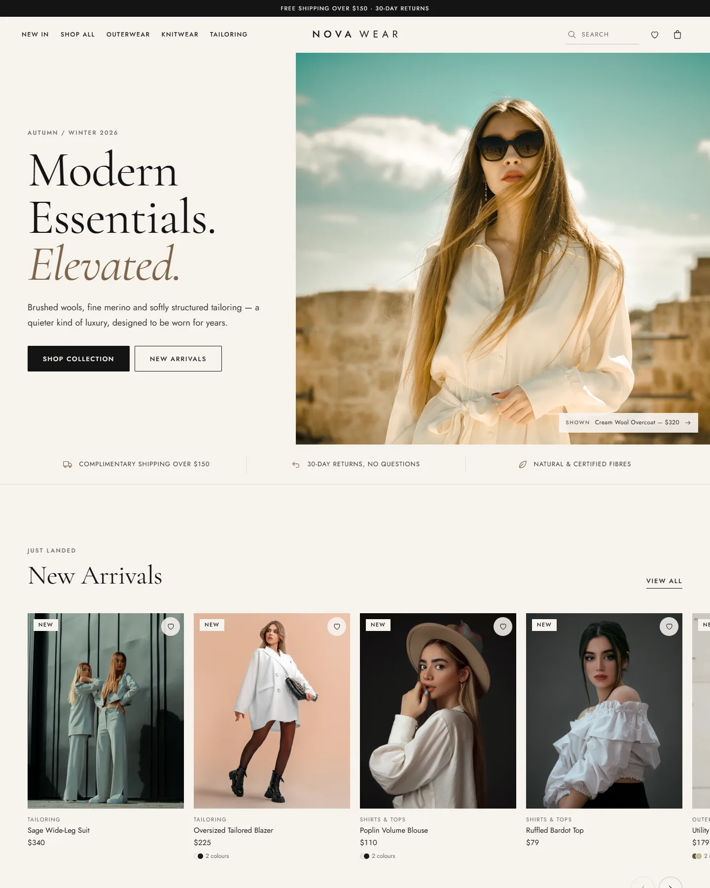
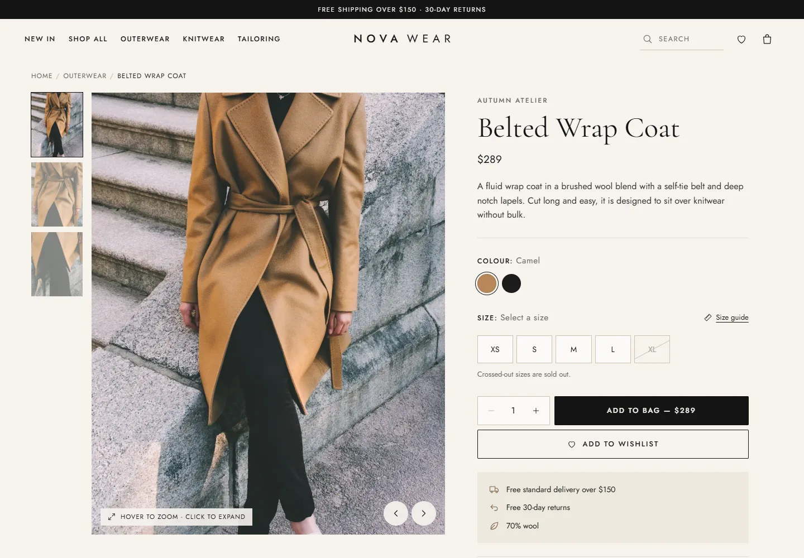
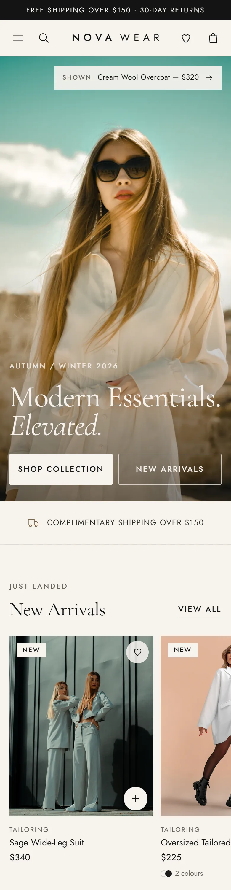
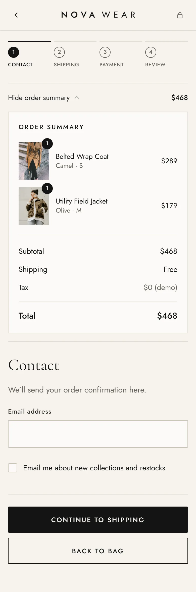

# NOVA WEAR — Modern Essentials. Elevated.

A premium fashion e-commerce **concept** built with Vite + React and hand-written CSS.
NOVA WEAR is a fictional brand created as a portfolio piece for web and app design: an editorial,
minimal storefront with a complete frontend shopping flow, from browsing and filtering to cart,
wishlist and a four-step checkout.

> **Disclaimer:** this is a demo. There is no backend, no real inventory, and **no payment processing**.
> The checkout's payment step is clearly marked *DEMO ONLY*; card fields are validated for format only and
> are never stored or sent anywhere. The site ships with `noindex, nofollow`.

---

## Live demo

**🔗 Live demo:** [nova-wear-store.netlify.app](https://nova-wear-store.netlify.app)

## Screenshots

### Desktop — Home


### Desktop — Product Details


### Mobile — Home


### Mobile — Checkout


<sub>Captured from the live site at 1440 px (desktop) and 390 px (mobile).</sub>

---

## Features

**Storefront**
- Editorial home page: split hero, new-arrivals carousel, featured collection, category cards,
  campaign section, best sellers, promotional banner and newsletter sign-up
- 24 demo products across 7 categories and 4 collections, all defined in one data file

**Shop**
- Product grid with category, price, size and colour filters (multi-select)
- Live facet counts — each option shows how many results it would return; empty options are disabled
- Sorting (featured, newest, price ↑/↓), in-page search, quick filters (New In / Best Sellers / Sale)
- Active filter chips, “Clear all”, and a result count
- All filter state lives in the URL, so filtered views are shareable and survive refresh/back
- Mobile/tablet filter drawer with a “Show N results” action

**Product cards**
- Hover reveals a second (detail) image on pointer devices
- Wishlist toggle, sale/new badges, colour count
- Quick add: one-size items go straight to the bag; otherwise an inline size picker appears
  (sold-out sizes are disabled)

**Product details**
- Gallery with thumbnails, hover zoom (2×, follows the cursor) and a full-screen lightbox with keyboard arrows
- Swipeable scroll-snap gallery on mobile with position indicators
- Colour and size selectors (sold-out sizes crossed out and disabled), quantity control
- Size guide drawer with measurement tables (apparel and denim)
- Details & fit, composition & care, delivery & returns accordions
- Related products, and a sticky “Add to bag” bar on mobile once the main button scrolls away

**Cart, wishlist & search**
- Cart drawer + full cart page: quantity controls, remove, subtotal, shipping, total
- Free-shipping progress meter
- Wishlist with “Move to bag” (asks for a size when needed)
- Cart and wishlist persist in `localStorage`
- Search overlay with popular searches, matching categories/collections, product results and an empty state;
  searches name, category, collection and colour

**Checkout (UI only)**
- Four steps — Contact → Shipping → Payment → Review — with a progress stepper
- Field-level validation on blur and on continue, with focus moved to the first invalid field
- Delivery method selection (standard / express) that updates totals
- Collapsible order summary on mobile, sticky summary on desktop
- Demo confirmation screen with a generated order number; the cart is cleared afterwards

**Polish**
- Toast notifications (add to bag, wishlist) with a “View bag” action
- Empty states for bag, wishlist, search and filters; 404 page
- Image fade-in, loading placeholders, route loading indicator

---

## Tech stack

| | |
|---|---|
| Build | [Vite 5](https://vitejs.dev) |
| UI | React 18 |
| Routing | React Router 6 |
| Styling | Plain CSS with custom properties (no UI framework) |
| State | React Context + `localStorage` |
| Fonts | Cormorant Garamond (display) + Jost (text), via Google Fonts |

Three runtime dependencies in total: `react`, `react-dom` and `react-router-dom`. Icons are inline SVG components.

---

## UI / UX decisions

- **Palette:** ink black `#141414`, off-white paper `#F6F3EE`, warm greys and a single muted beige accent.
  Colour is left to the photography; the interface stays quiet.
- **Typography:** a high-contrast serif (Cormorant Garamond) for display type gives an editorial,
  magazine-like voice; a geometric sans (Jost) keeps UI text clean and legible. Small uppercase,
  letter-spaced labels act as a consistent “eyebrow” system.
- **Image hierarchy:** every product image uses a 4:5 portrait ratio. Detail shots are real focal-point
  crops of the same photograph, which gives hover states and galleries a convincing fabric close-up.
- **Restraint in motion:** only opacity and transform transitions (fades, image swaps, drawer slides);
  no animation library. `prefers-reduced-motion` turns motion off.
- **Layout:** asymmetric, editorial splits (hero, featured collection, campaign) alternate with calm
  product grids so the page has rhythm without clutter.
- **Commerce patterns:** quick add, visible sold-out states, a free-shipping meter, a sticky mobile
  add-to-bag bar and a mobile order-summary toggle are all patterns real fashion retailers use to cut friction.

## Responsive design

Designed mobile-first and checked at **1440, 1024, 768, 430 and 390 px**.

- Header collapses to a menu / search / wishlist / bag layout with a slide-in mobile menu below 1100 px
- Hero switches from a desktop split to a full-bleed image with overlaid copy on mobile
- Product grids: 2 → 3 → 4 columns; carousels use native scroll-snap
- Shop filters move from a sticky sidebar (≥1100 px) to a drawer
- Product gallery becomes a swipe carousel; the info column stops being sticky
- Checkout collapses to one column with a toggleable summary
- Touch targets are at least 40–44 px; inputs use 16 px text to prevent iOS zoom; no horizontal overflow

## Performance

- All imagery is **WebP**, served at two widths via `srcset`/`sizes`, with explicit `width`/`height`
  to prevent layout shift
- Below-the-fold images use `loading="lazy"` and `decoding="async"`; the hero is `fetchpriority="high"`
- **Route-level code splitting** with `React.lazy`: shop, product, cart, wishlist, checkout and 404
  load on demand; React and the router are split into a cached vendor chunk
- No UI kit, no animation library, no icon font
- Fonts load with `display=swap` and `preconnect`

## Accessibility

- Semantic landmarks (`header`, `nav`, `main`, `footer`, `aside`), one `h1` per page, and a skip link
- Descriptive `alt` text on editorial and product images; decorative duplicates use `alt=""`
- All form controls have labels; errors are linked with `aria-describedby` and `aria-invalid`
- Drawers and dialogs trap focus, close with <kbd>Esc</kbd> and return focus to their trigger
- Colour and size options are real radio inputs; toggles use `aria-pressed`
- Toasts and result counts are announced through `aria-live` regions
- Visible `:focus-visible` outlines everywhere; text colours meet WCAG AA contrast on the paper background
- Respects `prefers-reduced-motion`

## SEO

- Page titles and meta descriptions per route (product pages include name and price)
- Open Graph and Twitter card tags, with a 1200×630 share image
- Canonical link updated per route (placeholder origin in `src/hooks/useDocumentMeta.js`)
- SVG favicon
- **`noindex, nofollow`** meta tag and a disallow-all `robots.txt`, because this is a demo

---

## Local setup

Requirements: **Node.js 18+**

```bash
npm install
npm run dev       # start the dev server at http://localhost:5173
npm run build     # production build to /dist
npm run preview   # serve the production build locally
```

### Project structure

```
public/
  images/
    products/      # 3 views per product × 2 widths (600, 1000), WebP
    editorial/     # campaign, collection, promo, newsletter
    hero/
    categories/
  favicon.svg  og-image.jpg  robots.txt  _redirects
src/
  components/      # Header, MobileMenu, Hero, ProductCard, ProductGrid, ProductRail, Filters,
                   # SearchOverlay, ProductGallery, SizeSelector, ColorSelector, SizeGuide,
                   # CartDrawer, CartLine, QuantityControl, WishlistButton, Newsletter, Footer, Toast…
  context/         # StoreContext: cart, wishlist, toasts, drawer state
  data/products.js # centralised catalogue, categories, collections, search helper
  hooks/           # useLocalStorage, useModal (focus trap / Esc / scroll lock), useDocumentMeta
  pages/           # Home, Shop, Product, Cart, Wishlist, Checkout, NotFound
  styles/base.css  # design tokens, typography, buttons, forms, shared primitives
  utils/format.js  # currency formatting, shipping rules
```

### Deployment

It's a static SPA. `public/_redirects` (Netlify) and `vercel.json` (Vercel) rewrite all routes to
`index.html` so deep links such as `/product/cream-wool-overcoat` work.

---

## Future improvements

- Headless CMS or commerce backend (e.g. Shopify Storefront API) for products and inventory
- Real payments via a hosted provider (Stripe Checkout / Payment Element), never handling raw card data
- Per-colour product imagery and variant-level stock
- Customer accounts, order history and saved addresses
- Server-side rendering or prerendering (e.g. Vite SSR / Astro) for real SEO and faster first paint
- Recently viewed products, reviews and fit feedback
- Automated tests (Vitest + Testing Library, Playwright for end-to-end flows) and Lighthouse CI
- Internationalisation: currencies, sizes and translations

## Disclaimer

NOVA WEAR is a fictional brand made for a design portfolio. Products, prices and copy are invented.
No orders are fulfilled, no emails are sent and no payment is processed. Photography is from Unsplash
under the Unsplash License — see [IMAGE_CREDITS.md](IMAGE_CREDITS.md).
